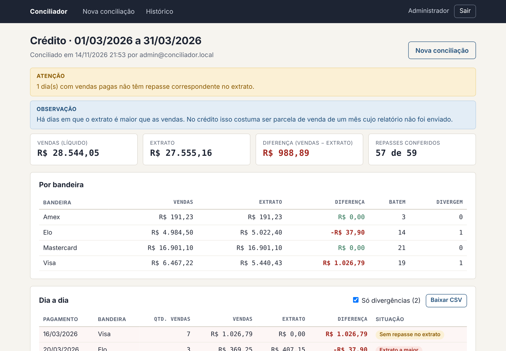
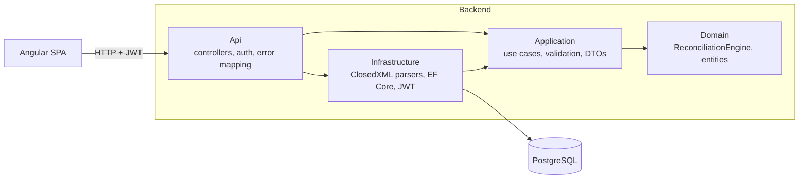
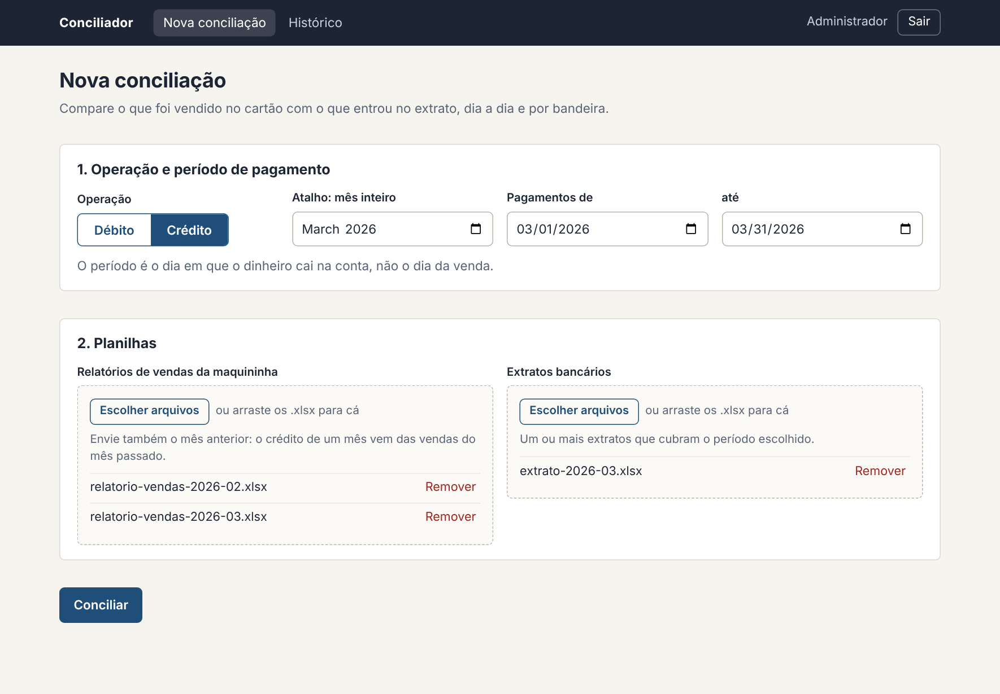
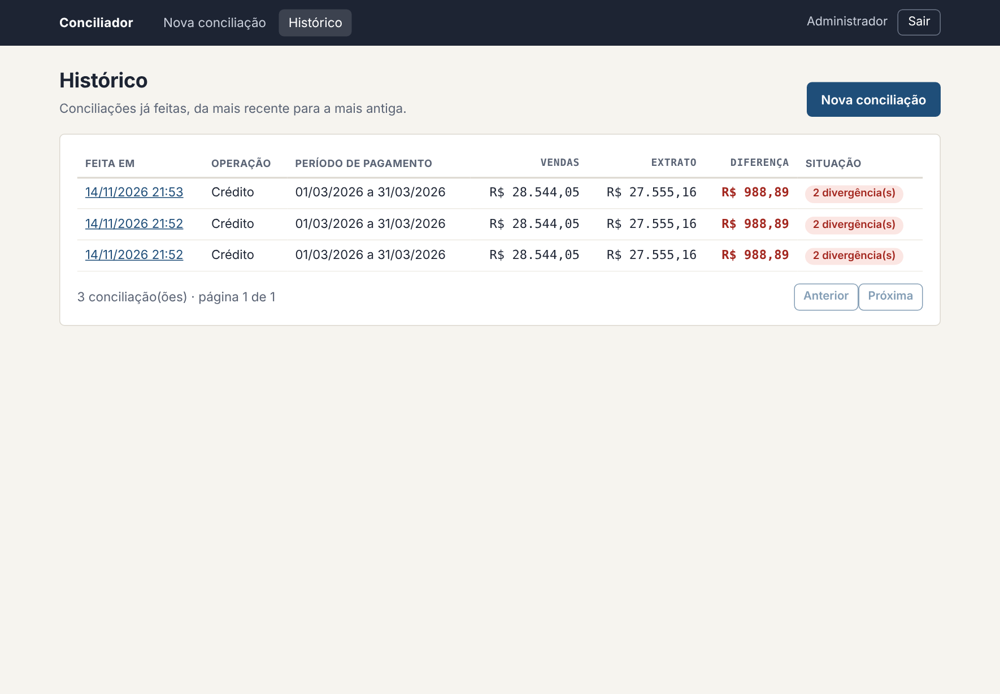

# Conciliador — card sales × bank statement reconciliation

[](https://github.com/Fa7Ken/projeto-FullStack-conciliador/actions/workflows/ci.yml)


Full-stack tool built for an accounting firm that reconciles supermarket card sales against the money that actually lands in the bank account. It replaces a manual routine of filtering thousands of spreadsheet rows and adding them up until they match a line on the statement.

> 🇧🇷 [Leia em português](#-em-português)



## The problem

Every month the accountant receives two kinds of spreadsheets per client:

- **Sales reports** exported by the card machine provider: one row per sale or installment (about 14,000 rows a month for a single store).
- **Bank statements**: around 4,500 rows a month, of which only about 130 are card settlements. The rest is PIX, boletos and transfers.

The bank pays one lump sum per day, per operation (debit or credit) and per card brand. To check it, someone has to sum every sale whose *effective payment date* falls on that day. Credit is the hard part: money received in March comes from February sales, and installments reach back even further, so several reports are needed at once.

## What the tool does

1. The user picks **debit or credit** and a **payment date range** (the day the money lands, not the day of the sale).
2. The user uploads **one or more files per side**.
3. Sales are summed by effective payment date and card brand, using the **net amount** (after the provider fee).
4. The statement is filtered down to card settlements; everything else is discarded.
5. Both sides are shown **day by day, per brand**, with `difference = sales − statement`.
6. When something cannot match, the tool **says why** instead of just showing a number.

| Situation | What the user sees |
|---|---|
| Nothing in the range on either side | Error: the spreadsheets do not cover the selected range |
| Statement does not cover part of the range | Warning with the uncovered days |
| Previous month's sales report was not uploaded | Warning that the first days may not match |
| A settlement with no sales, or sales with no settlement | Row flagged, plus a count |
| Credit day where the statement is higher than sales | Note that it is probably an installment from a report not uploaded |
| File on the wrong side, missing columns, not an `.xlsx` | Clear message naming the file and the missing columns |

## Stack

| Layer | Technology |
|---|---|
| API | C# 12, .NET 8, ASP.NET Core Web API, FluentValidation, Swagger/OpenAPI |
| Spreadsheets | ClosedXML |
| Persistence | EF Core 8 with migrations, PostgreSQL 16 |
| Auth | JWT bearer, PBKDF2 password hashing, login rate limiting |
| Frontend | Angular 22 (standalone, zoneless, signals), TypeScript |
| Tests | xUnit, FluentAssertions, `WebApplicationFactory`, Vitest |
| Delivery | Docker, Docker Compose, GitHub Actions |

## Architecture

Clean Architecture: dependencies point inwards, and the reconciliation rule lives in the domain with no framework around it.



```
src/
  Conciliador.Domain           reconciliation engine, entities, issue rules
  Conciliador.Application      use cases, validators, DTOs, ports
  Conciliador.Infrastructure   spreadsheet parsers, EF Core, repositories, security
  Conciliador.Api              controllers, JWT, ProblemDetails, Swagger
tests/
  Conciliador.UnitTests        engine, parsers, validation, hashing
  Conciliador.IntegrationTests API end to end over HTTP
  Conciliador.TestData         builders for fictitious spreadsheets
tools/
  Conciliador.SampleGenerator  generates the files in samples/
conciliador-web/               Angular app
samples/                       fictitious spreadsheets ready to upload
```

Design decisions worth pointing out:

- **Columns are located by header title, not by letter.** The provider's export has the header on row 5 and a duplicated "Tipo de cartão" column; the parser handles both and survives column reordering.
- **Card brands are dynamic.** Whatever appears in the files is reconciled, and spellings are normalised (`MASTER` on the statement is `Mastercard` on the report).
- **Net amount, not gross.** The statement is already net of the provider fee, so gross would never match.
- **The engine is a pure domain service.** Parsed files in, reconciliation out. That is what makes it testable without files or a database.

## Running it

### With Docker (API + web + database)

```bash
cp .env.example .env      # then set POSTGRES_PASSWORD, JWT_KEY and ADMIN_PASSWORD
docker compose up --build
```

- App: http://localhost:8080
- Swagger: http://localhost:5080/swagger

Sign in with the `ADMIN_EMAIL` and `ADMIN_PASSWORD` you set in `.env`. Migrations run and the admin user is created on first start.

### Locally

Requirements: .NET 8 SDK, Node 22 and a PostgreSQL on `localhost:5432` (database, user and password `conciliador`).

```bash
dotnet run --project src/Conciliador.Api --launch-profile http   # http://localhost:5080/swagger
cd conciliador-web && npm ci && npm start                        # http://localhost:4200
```

Development login: `admin@conciliador.local` / `Conciliador@123` (from `appsettings.Development.json`, local use only).

### Try it with the sample files

The `samples/` folder has fictitious spreadsheets in the same layout as the real ones:

| File | Side |
|---|---|
| `relatorio-vendas-2026-02.xlsx`, `relatorio-vendas-2026-03.xlsx` | Sales reports |
| `extrato-2026-03.xlsx` | Bank statement |

Choose March 2026 as the month. Three divergences were planted on purpose:

| Operation | Day | What you should find |
|---|---|---|
| Debit | 02/03/2026 | Mastercard is R$ 150.00 short on the statement (card machine rental discounted) |
| Credit | 16/03/2026 | Visa sales with no settlement on the statement |
| Credit | 20/03/2026 | Elo statement R$ 37.90 higher than sales (installment from a report not uploaded) |

Upload only the March sales report with **Credit** to see the missing-previous-month warning.

To regenerate the samples: `dotnet run --project tools/Conciliador.SampleGenerator`.

## API

All endpoints except login require `Authorization: Bearer <token>`.

| Method | Route | Description |
|---|---|---|
| `POST` | `/api/auth/login` | Returns a JWT |
| `POST` | `/api/reconciliations` | Runs a reconciliation (`multipart/form-data`) |
| `GET` | `/api/reconciliations?page=1&pageSize=20` | History, newest first |
| `GET` | `/api/reconciliations/{id}` | One reconciliation with lines, subtotals and issues |
| `GET` | `/health` | Health check |

`POST /api/reconciliations` fields: `operation` (`Debit` or `Credit`), `startDate`, `endDate` (`yyyy-MM-dd`), `salesFiles` (one or more) and `statementFiles` (one or more).

```bash
curl -X POST http://localhost:5080/api/reconciliations \
  -H "Authorization: Bearer $TOKEN" \
  -F operation=Debit -F startDate=2026-03-01 -F endDate=2026-03-31 \
  -F salesFiles=@samples/relatorio-vendas-2026-02.xlsx \
  -F salesFiles=@samples/relatorio-vendas-2026-03.xlsx \
  -F statementFiles=@samples/extrato-2026-03.xlsx
```

Errors follow RFC 7807 (`application/problem+json`): `400` for invalid input, `401` for missing or invalid credentials, `404` for unknown ids and `422` when a spreadsheet is not in the expected format.

## Tests

```bash
dotnet test                                   # 48 unit + 7 integration tests
cd conciliador-web && npx ng test --watch=false   # 10 frontend tests
```

- **Unit:** the reconciliation engine (matching, differences, one-sided days, coverage warnings), both parsers against generated workbooks, validation and password hashing.
- **Integration:** the whole API over HTTP, from login to upload to history. PostgreSQL is swapped for in-memory SQLite to keep the suite fast.
- **CI:** builds and tests backend and frontend, applies the migrations on a real PostgreSQL, then starts the Docker Compose stack and logs in through the web container.

## Screens

| New reconciliation | History |
|---|---|
|  |  |

## Data privacy

No client data is in this repository. Every spreadsheet under `samples/` and every test fixture is generated by code with invented names and values, and `.gitignore` blocks any other `.xlsx`.

## Next steps

- Second phase of the project: scope still being defined with the accounting firm.
- Recognise known recurring discounts (such as card machine rental) and label them instead of only showing the difference.
- Support other providers and banks through additional parser implementations behind the existing interfaces.
- Export the result to `.xlsx` on the server, in addition to the current CSV export.
- User management (today a single admin user is seeded).

---

## 🇧🇷 Em português

Ferramenta full stack feita para um escritório de contabilidade que precisa conferir as vendas em cartão de supermercados com o que de fato entrou na conta bancária. Ela substitui a rotina manual de filtrar milhares de linhas de planilha e somar até bater com um lançamento do extrato.

### O problema

Todo mês chegam dois tipos de planilha por cliente:

- **Relatórios de vendas** da maquininha: uma linha por venda ou parcela (cerca de 14 mil linhas por mês em uma única loja).
- **Extratos bancários**: cerca de 4.500 linhas por mês, das quais só umas 130 são repasses de cartão. O resto é PIX, boleto e transferência.

O banco paga um valor único por dia, por operação (débito ou crédito) e por bandeira. Para conferir, é preciso somar todas as vendas cuja *data efetiva de pagamento* cai naquele dia. O crédito é a parte difícil: o que entra em março vem das vendas de fevereiro, e as parcelas vêm de ainda mais longe, então vários relatórios são necessários ao mesmo tempo.

### O que a ferramenta faz

1. O usuário escolhe **débito ou crédito** e o **intervalo de datas de pagamento** (o dia em que o dinheiro cai, não o dia da venda).
2. Envia **um ou mais arquivos de cada lado**.
3. As vendas são somadas por data efetiva de pagamento e bandeira, pelo **valor líquido**.
4. O extrato é filtrado para ficar só com os repasses de cartão.
5. Os dois lados aparecem **dia a dia, por bandeira**, com `diferença = vendas − extrato`.
6. Quando algo não bate, a ferramenta **explica o motivo**: planilhas fora do período, relatório do mês anterior faltando, dia sem repasse, possível parcela de relatório não enviado, arquivo no lado errado ou fora do formato.

### Como rodar

```bash
cp .env.example .env      # defina POSTGRES_PASSWORD, JWT_KEY e ADMIN_PASSWORD
docker compose up --build
```

- Aplicação: http://localhost:8080
- Swagger: http://localhost:5080/swagger

Entre com o `ADMIN_EMAIL` e o `ADMIN_PASSWORD` definidos no `.env`.

### Testando com os arquivos de exemplo

A pasta `samples/` tem planilhas fictícias no mesmo layout das reais. Escolha o mês de março de 2026, envie os dois relatórios de vendas e o extrato, e você encontrará três divergências plantadas de propósito: um desconto de R$ 150,00 no débito Mastercard do dia 02/03, um dia de crédito Visa sem repasse (16/03) e um crédito Elo com R$ 37,90 a mais no extrato (20/03).

### Privacidade

Nenhum dado de cliente está neste repositório. Todas as planilhas de `samples/` e dos testes são geradas por código, com nomes e valores inventados.
